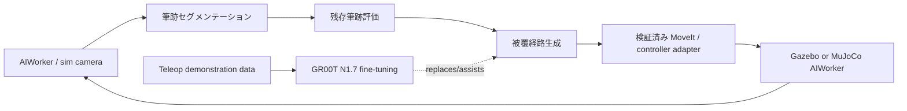

# 実装計画

## 到達目標

AIWorkerがホワイトボードの筆跡を観測し、消し具を持つ手先で筆跡領域を複数回走査して消去する。動作後に同じカメラで残存筆跡を計測し、残った行だけを再実行する。

## システム構成

## 段階

1. **モデル固定**: 対象AIWorker型式を確認し、対応するassetを選ぶ。`cyclo_lab` の公開assetが対象型式と一致する場合はIsaac Labを第一候補にし、取得commitとvariantを記録する。合わない場合はROBOTIS配布のURDF/SDF（Gazebo）またはMJCF（MuJoCo）を確認し、ROS 2・シミュレータ版も記録する。独自変換したモデルは手順と差分を残す。
2. **シーン構築**: 白板面、筆跡テクスチャ、消し具、固定カメラ、床・障害物を置く。白板の4隅、工具先端、カメラのTFを確認する。
3. **安全な経路**: `path_planner.py` が生成する白板座標のラスター経路を、MoveIt等の確認済みプランナで衝突チェックする。接触開始・解除は白板法線方向に分離し、接触力と速度に上限を設定する。
4. **視覚評価**: 消去前後の筆跡マスク、白板マスク、対象文字ROIマスクを `erase_assessment.py` に与える。消去率は対象ROI内の検出筆跡画素数の減少率。別指標は白板外での筆跡マスク画素変化率であり、原画像全体の変化や白板損傷を示す指標ではない。初期の設計目標は消去率90%以上、白板外の筆跡マスク変化率1%以下であり、実験結果ではない。
5. **閉ループ**: 残存マスクの連結領域を再走査対象とする。経路の有効範囲・最大試行回数・停止条件は設定ファイルに残す。
6. **実機移行**: シミュレータでカメラ、座標変換、速度、力、非常停止を確認してから、担当者立会いで一項目ずつ実機検証する。SH5を使う経路は、公式のDDS bridge例を参照して版・トピック・QoSを実機で確認する。

### シミュレータ選定の根拠と限界

ROBOTISの従来Simulationページでは、Gazebo用URDF/SDFとMuJoCo用MJCFが提供され、NVIDIA Isaac Sim USDは「upcoming」とされている。一方、ROBOTISの `cyclo_lab` と新しいOpen Source一覧には、AI Worker向けIsaac Lab環境・USD assetと `Cyclo-PickPlace-FFW-BG2...` 例がある。対象型式に一致する場合はCyclo Labを第一候補にする。**ホワイトボード文字消去は既製タスクではなく、本成果物で設計する新規タスクであり未実施である。**公式ページ間の情報差は、利用時点の取得commit・variantを残して解決する。

## ROS 2インターフェース

`aiworker_interface.example.yaml` の空値は、会社PCで実際に取得した `ros2 topic list -t`、`ros2 action list -t`、`ros2 run tf2_tools view_frames` に基づいて入力します。作業開始時点で分かっているのは「接続とtopic取得まで確認済み」のみであり、対象型式、トピック名・型・制御器・MoveIt構成は未確認です。SH5を使う場合も、公開されたDDS bridge例を実際のソフトウェア版へ照合する必要があります。このため、`ros_bridge.py` はメタデータを最大1件/秒、1実行あたり最大300件まで記録するだけで、画像自体の変換・保存、推論、推測した制御コマンドの送信を行いません。

## GR00T N1.7への発展

AIWorker向けにGR00T N1.7を使うには、AIWorkerのカメラ、関節状態、工具先端の相対EEF actionを時刻同期して収録し、LeRobot形式へ変換する。収録デモは少なくとも以下を含める。

- 筆跡位置・色・線幅、照明、白板高さ、消し具摩耗を変えた成功・失敗例
- 観測画像、camera intrinsics/extrinsics、joint state、tool pose、行動、言語指示、停止イベント
- 収録・変換・学習・評価を別splitにし、実機で用いた試行を学習データへ混入させない管理記録

GR00T N1.7の公開実装はカスタムembodimentを前提にファインチューニングでき、GPUサーバとロボット側ROS 2クライアントをZMQ等で分離する構成を採れます。ただし、AIWorkerが公式に対応済みのembodimentではないため、既製チェックポイントをゼロショットで制御器として使う計画にはしません。先にカスタムembodimentと収録データの妥当性を確認します。

参考: [NVIDIA Isaac GR00T](https://github.com/NVIDIA/Isaac-GR00T), [GR00T real-world deployment guide](https://github.com/NVIDIA/Isaac-GR00T/blob/main/getting_started/real_world_deployment.md)
